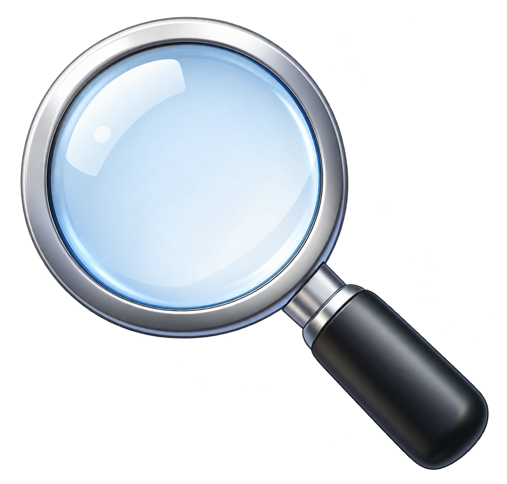

<p align="center">
  
</p>

<h1 align="center">proofrag</h1>

<p align="center">
  <a href="https://pypi.org/project/proofrag/"></a>
  <a href="https://pypi.org/project/proofrag/"></a>
  <a href="https://github.com/unshDee/proofrag/actions/workflows/ci.yml"></a>
  <a href="https://github.com/unshDee/proofrag/blob/v0.10.0/LICENSE"></a>
</p>

**Catch RAG regressions before they ship.** Build a golden set from your own docs, run
your app, score retrieval and answers separately, and fail CI when a metric drops.

Use it as a Python CLI, a GitHub Action, or an [Agent Skill](https://agentskills.io)
for Claude Code, Codex, Cursor and other agents.

<p align="center">
  
</p>

## Quick start

See a scorecard in 5 seconds, no API key needed:

```bash
pipx install "proofrag[anthropic]"        # or: pip / uv tool install / uvx
proofrag demo --out scorecard.html && open scorecard.html
```

Or walk through your own project with the guided wizard:

```bash
pipx install "proofrag[anthropic,tui]"
proofrag wizard
```

Use `[openai]` for OpenAI, or for a local, OpenAI-compatible server such as Ollama.
In Claude Code, run `/plugin marketplace add unshDee/proofrag`, then
`/plugin install proofrag@proofrag`, and ask it to *"evaluate my RAG"*.

<p align="center">
  
</p>

## The loop

```bash
proofrag generate --corpus ./docs --out goldenset.jsonl --n 20        # golden set from your docs
proofrag validate --goldenset goldenset.jsonl --corpus ./docs         # review before committing
proofrag run --goldenset goldenset.jsonl --callable myapp.rag:answer --out predictions.jsonl
proofrag evaluate --goldenset goldenset.jsonl --predictions predictions.jsonl --out results.json
proofrag report --results results.json --out scorecard.html
```

Gate it in CI with the GitHub Action:

```yaml
- uses: unshDee/proofrag@v0.10.0
  env:
    ANTHROPIC_API_KEY: ${{ secrets.ANTHROPIC_API_KEY }}
  with:
    goldenset: eval/goldenset.jsonl
    predictions: predictions.jsonl
    baseline: eval/baseline.json    # fail if any metric regresses
```

## Why proofrag

- **Golden sets grounded in your docs.** Single-document, multi-document and
  *unanswerable* cases, validated before they become a baseline.
- **Retrieval and generation are scored separately.** Recall@k, NDCG@k and MRR show
  whether the evidence arrived. Answer metrics show what the model did with it.
- **Reproducible runs.** Every run records the judge, prompt version, matcher and
  dataset fingerprint, and `diff` refuses to compare mismatched runs.
- **Blind A/B.** Compare two variants on the same cases, with answer order randomized.
- **Portable.** Self-contained HTML reports. Anthropic, OpenAI or local models, or
  score with DeepEval, Ragas or Jev.

## Docs

| | |
|---|---|
| [The evaluation loop](https://github.com/unshDee/proofrag/blob/v0.10.0/docs/workflow.md) | Corpus loading, validation, prediction adapters, metrics |
| [CI gates](https://github.com/unshDee/proofrag/blob/v0.10.0/docs/ci.md) | Score floors, baseline diffs, the GitHub Action |
| [A/B and case studies](https://github.com/unshDee/proofrag/blob/v0.10.0/docs/compare.md) | Blind comparisons and three reproducible studies |
| [Judges and providers](https://github.com/unshDee/proofrag/blob/v0.10.0/docs/judges.md) | Providers, env vars, DeepEval, Ragas, Jev |
| [Agent Skill](https://github.com/unshDee/proofrag/blob/v0.10.0/AGENTS.md) | Use proofrag from Claude Code, Codex and other agents |
| [Upgrading](https://github.com/unshDee/proofrag/blob/v0.10.0/docs/upgrading.md) | Baseline changes between versions |

## Contributing

Issues and PRs are welcome; see
[CONTRIBUTING.md](https://github.com/unshDee/proofrag/blob/v0.10.0/CONTRIBUTING.md).
Security notes are in [SECURITY.md](https://github.com/unshDee/proofrag/blob/v0.10.0/SECURITY.md).
MIT licensed.
