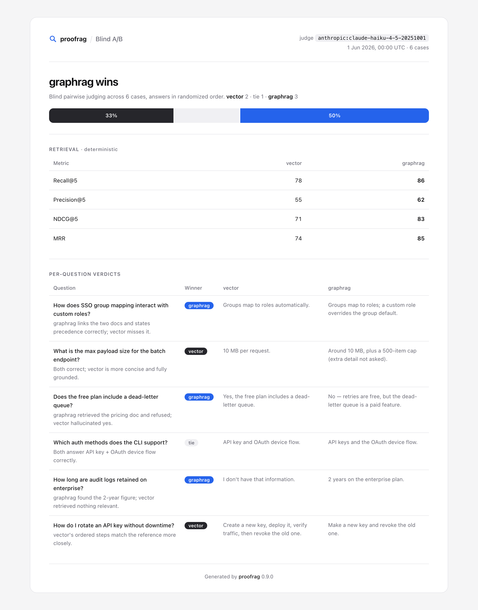

# A/B: compare two RAG variants

To compare two setups, such as vector search against GraphRAG, two prompts, or two
models, run both over the **same** golden set. The **same** judge then compares the
answers question by question. Answer order is randomized, so neither variant always
appears first.

```bash
proofrag compare --goldenset goldenset.jsonl \
  --a vector_preds.jsonl   --a-name vector \
  --b graphrag_preds.jsonl --b-name graphrag \
  --out comparison.json --html comparison.html
```



Each variant's retrieval metrics sit beside the verdict, so you can tell whether a win
came from better retrieval or better generation.

## Case studies

Three reproducible studies apply this to real changes. Each one uses a hash-checked
official corpus, a reviewed golden set, retained raw artifacts, blind A/B judging, and
a limitations section.

| Question | Corpus | Result |
|----------|--------|--------|
| [Does SQLite FTS5 beat unique-token overlap?](../case_studies/python_concurrency/REPORT.md) | Python 3.14 concurrency docs, 30 cases | FTS5 won 13–6, with 11 ties; the gap was largest on multi-document questions |
| [Does RFC section metadata improve BM25?](../case_studies/http_rfc_metadata/REPORT.md) | Seven HTTP RFCs, 21 cases | NDCG@5 rose 0.018, below the predeclared 0.05 bar |
| [Does doubling OWASP context improve answers?](../case_studies/owasp_context_depth/REPORT.md) | Six OWASP Cheat Sheets, 24 cases | Recall@6 rose 0.024, but top-3 won 7–5 (12 ties) |

Negative results are kept, so each study claims only what its experiment shows. Each
study folder has a `README.md` with steps to reproduce it and an `artifacts/` folder
with the raw results.
